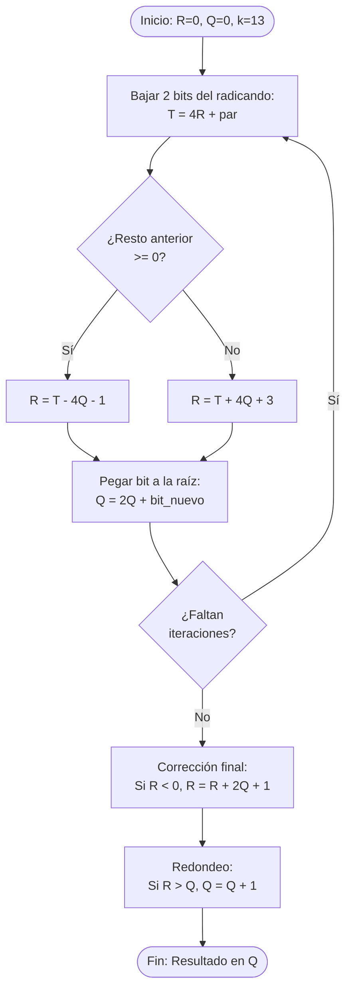
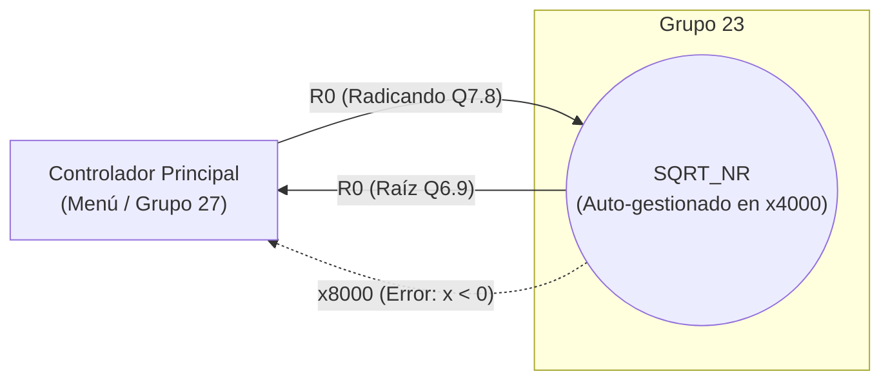

# Grupo 23 · SQRT

**Consigna:** Non-Restoring

## Integrantes
- De Los Santos, Dahiara Claribel (@dahizz)
- Kamchem, Melina (@melika2332)
- Wereszczuk, Danna Maira (@wereszczukdanna-cell)

## Archivos
- `alto_nivel/lab3a.cpp`: Programa en C++ con la demostración de conversión a formato Q, compatibilización de formatos (Q3.12 y Q7.8) y operaciones de suma, resta, producto y división.
- `asm/lab3a.asm`: Implementación en assembly LC-3 de las conversiones de formato y multiplicación en punto fijo, utilizando subrutinas de corrimiento (`SHL32`) y suma (`MULS`).
- `alto_nivel/sqrt_nr.cpp`: Análisis en C++ de la raíz cuadrada non-restoring, evaluación de formato, rango y precisión.
- `asm/modulo_sqrt_nr.asm`: Subrutina `SQRT_NR` en assembly LC-3 (diseñada como caja negra con gestión autónoma de registros y resguardo en memoria) lista para ser enlazada al menú principal.
- `bitacora_3a.md` y `bitacora_sqrt_nr.md`: Registros diarios de las sesiones de trabajo y optimización.

## Documentación Técnica (Lab 3b - SQRT Non-Restoring)
- **Algoritmo:** Raíz cuadrada "non-restoring" dígito a dígito (Li y Chu, 1996).
- **Ubicación en Memoria:** Segmento asignado en `0x4000` (Aislamiento total del kernel y del programa principal del sistema).
- **Integración y Compatibilidad:** Diseño encapsulado en "Caja Negra", 100% compatible con la interfaz del menú de la cátedra (`main_menu_one_q7_8`). La subrutina recibe el radicando exclusivamente en `R0`, devuelve la raíz en `R0`, y gestiona internamente sus iteraciones resguardando todos los registros del llamador (`R1` a `R5`) mediante directivas `ST` y `LD`.
- **Iteraciones (k):** 13 fijas inicializadas de forma interna. Es el máximo permitido para que el resto intermedio no desborde los registros de 16 bits con signo de la LC-3.

## Cómo probarlo
**Para Lab 3a:**
1. Cargar el archivo `asm/lab3a.asm` en el simulador de la LC-3.
2. Poner un breakpoint en `ST R1, X_Q8` para verificar el corrimiento aritmético a la derecha.
3. Poner un breakpoint en `M_SIG` dentro de la subrutina `MULS` para observar cómo crece el producto parcial en los registros R1 y R2.
4. Ejecutar paso a paso y revisar los valores guardados en memoria (ej. `PROD_Q8` debe dar `xFC2C`).

**Para Lab 3b (SQRT Non-Restoring Integrado):**
1. Loguearse en la plataforma `lc3.lgrum.xyz` y cargar el archivo `asm/modulo_sqrt_nr.asm` junto con el menú `main.asm` del grupo 27.
2. Poner un breakpoint en la etiqueta `SQRT_NR` para observar el desarrollo vuelta por vuelta y comprobar el resguardo inicial de los registros.
3. Ejecutar el programa y navegar por la consola interactiva: seleccionar la opción de Raíz Cuadrada (Non-Restoring) e ingresar un valor decimal.
4. Inspeccionar la correcta impresión del resultado Q6.9 traducido a decimal en la consola.

## Especificaciones para Verificación (Punto Fijo, Rangos y Precisión)

| Parámetro | Especificación Adoptada | Justificación Técnica |
| :--- | :--- | :--- |
| **Formato de Entrada** | **Q7.8** | El radicando se carga en la mitad alta para ganar precisión sin usar más registros. |
| **Formato de Salida** | **Q6.9** | Calculado con la fórmula $f = n/2 + k - 8 = 9$ bits fraccionarios. |
| **Rango de Entrada** | **[0 ; 127.996]** | Si la entrada es negativa, la rutina aborta y devuelve `x8000` indicando error al sistema central. |
| **Rango de Salida** | **[0 ; 11.3135]** | Límite matemático acotado por el valor máximo de entrada. |
| **Resolución (1 LSB)** | **0.00195** | Salida maximizada mediante la extracción de 9 bits fraccionarios. |
| **Error Máximo** | **0.00098 (½ LSB)** | Se garantiza el truncamiento óptimo gracias al redondeo al más cercano implementado en el último paso. |

## Casos Probados en el Simulador (Validación Empírica)
Resultados ingresados y verificados a través del menú interactivo del sistema central, demostrando la conversión hexadecimal y el manejo de excepciones:

| Radicando Decimal | Entrada Hex (Q7.8) | Raíz Decimal | Salida Hex (Q6.9) | Observación |
| :--- | :--- | :--- | :--- | :--- |
| `12.00` | `x0C00` | `3.46484375` | `x06EE` | Caso base sin raíz exacta. |
| `25.00` | `x1900` | `5.00` | `x0A00` | Raíz exacta entera. |
| `0.00` | `x0000` | `0.00` | `x0000` | Validación del límite inferior. |
| `-5.00` | `xFB00` | `NaN (imprime -64)` | `x8000` | Rechazo correcto de radicando negativo (El menú imprime -64 al interpretar el error `x8000` en Q6.9). |

## Arquitectura y Métricas de Desempeño (Benchmark)
El módulo fue sometido a pruebas de estrés y optimización a nivel de ISA, arrojando las siguientes métricas de rendimiento en la máquina virtual LC-3:

| Métrica | Valor Alcanzado | Observación |
| :--- | :--- | :--- |
| **Uso de Memoria** | 55 Palabras (Código) | Altamente eficiente, sin tablas LUT anexas. |
| **Complejidad Temporal** | 276 a 334 instrucciones | Ejecución acotada por $k=13$ ciclos fijos (determinista), ideal para tiempo real. |
| **Optimización ISA** | 0 Multiplicaciones / 0 Divisiones | Solo requiere Sumas, Complemento a 2 y saltos por bit de signo. |
| **Resguardo en Memoria** | Variables Locales (ST/LD) | Evita uso de pila y blinda los registros R1 a R5 del menú. |

## Diagrama de Flujo: Lazo Principal SQRT Non-Restoring

## Integración de la Interfaz (Black-Box)

